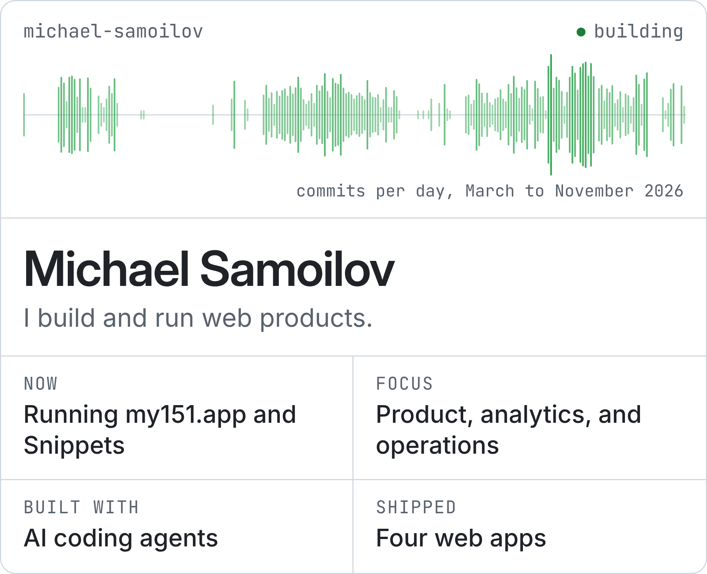
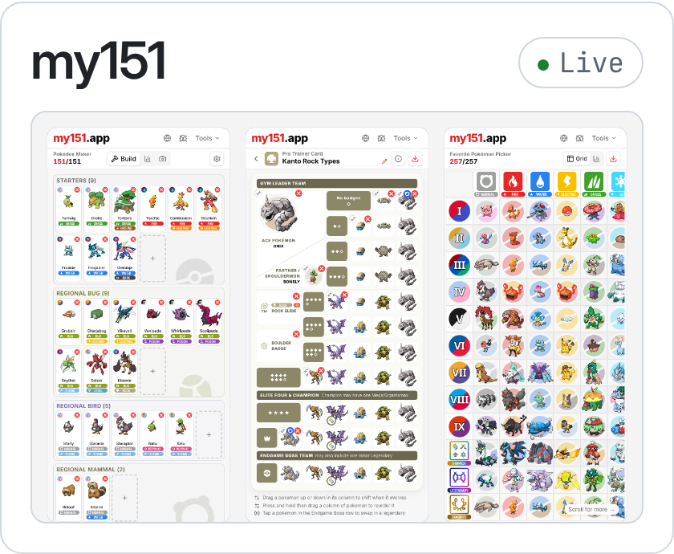
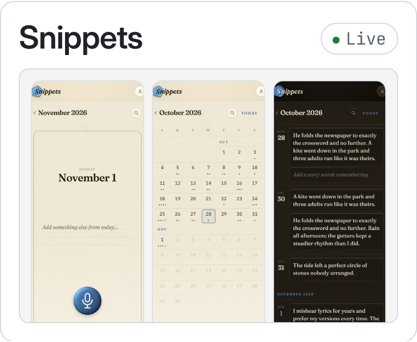
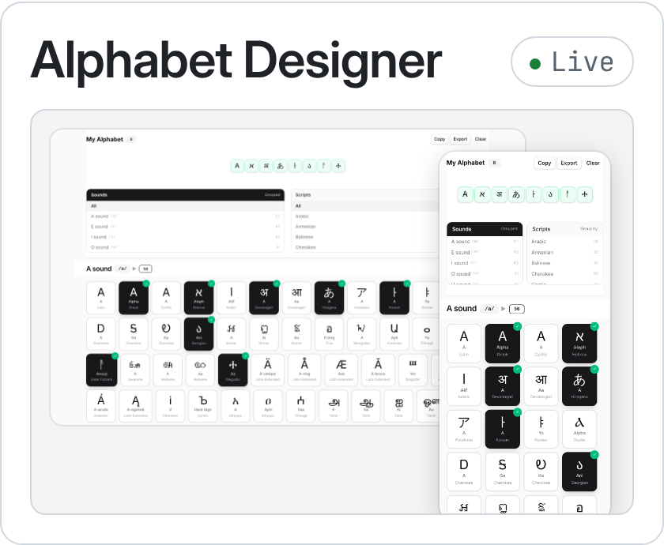
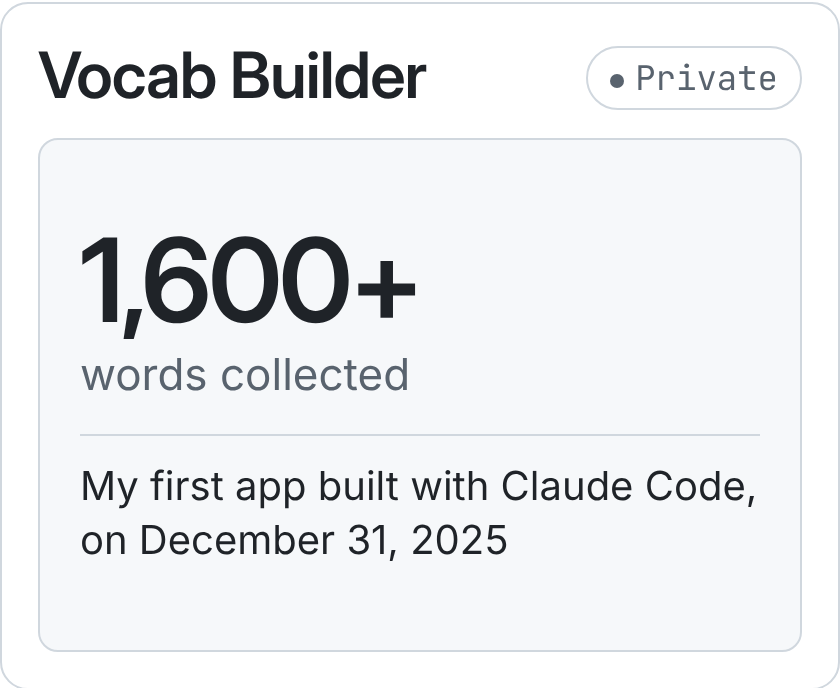

<picture><source media="(prefers-color-scheme: dark)" srcset="assets/hero-dark.png"></picture>

## What I've built

  <a href="https://my151.app"><picture><source media="(prefers-color-scheme: dark)" srcset="assets/card-my151-dark.png"></picture></a>
  <a href="https://www.snippets.ink"><picture><source media="(prefers-color-scheme: dark)" srcset="assets/card-snippets-dark.png"></picture></a>

- **[my151.app](https://my151.app)** ([code](https://github.com/michael-samoilov/my151-public)): free browser tools for Pokémon fans. Build a regional Pokédex, design a Pokémon League of gym leaders, and pick your favorites. Live with real users, in nine languages, with an analytics dashboard and performance budgets.
- **[Snippets](https://www.snippets.ink)** ([code](https://github.com/michael-samoilov/snippets-public)): a local-first journal for the day's stories. Speak or type a few words; entries stay on your device, work offline, and sync with end-to-end encryption.

The code for my151 and Snippets is public, with its full history.

## Earlier projects

  <a href="https://alphabet-draft.vercel.app"><picture><source media="(prefers-color-scheme: dark)" srcset="assets/card-alphabet-dark.png"></picture></a>
  <picture><source media="(prefers-color-scheme: dark)" srcset="assets/card-vocab-dark.png"></picture>

- **[Alphabet Designer](https://alphabet-draft.vercel.app)** ([code](https://github.com/michael-samoilov/Alphabet-draft)): pick characters from 32 writing systems and combine them into your own alphabet. It was the first time I realized I could build on the go: on the subway, I sent a prompt from my phone at one station, rode through the tunnel with no signal, and found the updated app waiting at the next station.
- **Vocab Builder** (private code): my personal vocabulary app, which replaced a Google Sheets workflow of more than 1,600 words. It was my first app built with Claude Code, on December 31, 2025, when Claude Code ran only in the terminal. Before that, I used Claude Code to fix compile errors while converting Rock Band songs I found online into a format I could play on my PS4.
